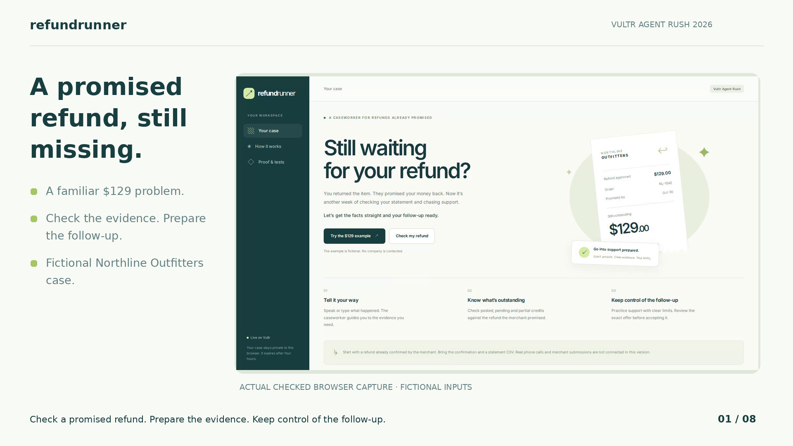
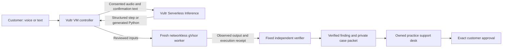

# Refund Runner

You returned a $129 item. The merchant confirmed the refund, but the credit still has not appeared. Refund Runner helps establish what is outstanding, prepares the evidence and lets you practice the support follow-up with a voice caseworker and explicit limits.

The first workflow is deliberately specific: **a refund the merchant has already promised**. A practice support conversation is a simulation. No company is called, no bank account is connected and no money is recovered by this version.

- [Web application](https://refund.139.84.249.47.sslip.io)
- [GitHub source and setup](https://github.com/NSEVEjk0/refund-runner)
- [Narrated demonstration](https://refund.139.84.249.47.sslip.io/demo/refund-runner-demo.mp4) · [slides](https://refund.139.84.249.47.sslip.io/demo/refund-runner-slides.pdf)
- [Source and setup ZIP](https://refund.139.84.249.47.sslip.io/source/refund-runner-source.zip)
- [Recorded fictional case](https://refund.139.84.249.47.sslip.io/demo/evidence.json) · [containment receipts](https://refund.139.84.249.47.sslip.io/demo/containment.json)
- [Official Vultr Agent Rush challenge](https://lablab.ai/ai-hackathons/vultr-hackathon)



## A complete case

1. **Tell your story.** Record a note of up to 35 seconds, upload audio or type. Vultr speech recognition transcribes the note, and the caseworker chooses an evidence step.
2. **Add the confirmation and statement.** Text PDF/UTF-8 confirmation and a statement CSV are decoded in a fresh networkless gVisor worker. The planner proposes cited facts from the confirmation; the bank CSV stays out of the code-generation prompt.
3. **Review the facts.** Confirm the amount, due date, merchant references, credit sign, original payment promise and statement coverage. A checked source quote establishes a verbatim span; the customer reviews its interpretation. Document authenticity is not verified.
4. **Check the money.** Vultr writes a reconciliation program. A new gVisor worker runs it on the customer-reviewed inputs and 13 fresh control cases. A fixed host verifier independently checks exact integer cents, matching references, duplicates, currency, status priority and coverage. One bounded repair attempt is allowed. Raw candidate errors never go into the retry prompt.
5. **Practice support under a mandate.** The owned desk offers store credit, asks for excessive data and then proposes matching terms. The model proposes typed actions. Trusted code enforces the mandate and renders the permitted response. A valid offer pauses for an exact customer review button.
6. **Take the packet.** Download the reviewed facts, calculation, original statement, extracted confirmation, execution receipts and an unsent follow-up draft. The practice receipt explicitly records zero money recovered and no real company contact.

The fictional Northline Outfitters examples cover an overdue $129 refund, an already-posted credit, a $40 partial credit, a pending credit, a merchant-only credit without a reference, a different currency and duplicate rows. They are labelled in the application and [fixtures](fixtures/README.md).

## Why the voice agent is useful

Voice is part of intake and case work. The customer explains the problem, hears the evidence step and verified finding, then hears the caseworker decline unauthorized offers in the practice conversation. Generated free-form speech cannot accept terms or disclose arbitrary fields. Speech is rendered from checked facts and trusted action templates.

The browser experience is turn-based. MediaRecorder produces a short WebM/Opus note; the networkless media worker normalizes it, then the controller sends the WAV to Vultr ASR. This is not a live telephone agent or full-duplex voice stream. WAV, MP3, M4A, FLAC and Ogg notes are also supported.

## Vultr architecture

This implements Pattern A from the official Blast Radius Zero brief: the model writes code, a sandbox executes it, the actual output returns and the model selects a grounded explanation. Vultr Cloud Compute runs the controller, state, workers and public web application. Vultr Serverless Inference supplies all agent model calls:

| Job | Model | Boundary |
| --- | --- | --- |
| Intake, fact proposal, Python generation, explanation and support action selection | `deepseek-v4.1-flash-1017` | Controller calls the fixed Vultr endpoint |
| Speech recognition | `qwen3-asr-1.7b` | Only consented, normalized short audio goes to inference |
| Spoken guidance | `qwen3-tts-12hz-1.7b`, built-in Ryan voice | Trusted text; returned audio is decoded in gVisor before playback |
| PDF, CSV, audio decoding and candidate Python | Pinned worker image | Nonroot gVisor; no network or controller credentials |
| Financial truth and approval | Fixed Python contracts | Outside the candidate interpreter; customer review required |



There is no public-policy browser integration in this version. A supplied, customer-reviewed explicit promise supplies the due date. The browser container used for UI testing is a separate test runner and is not an agent worker.

## Containment and approval

[The sandbox runner](refund/sandbox.py) creates a disposable container for every decoding or code task and inspects its applied Docker policy before starting it. It requires the full pinned gVisor bundle and an immutable worker image. There is no host interpreter or runc fallback.

- Runtime `runsc`; full bundle release `20261102.0` pinned in [runtime.py](refund/runtime.py).
- Nonroot user `65532:65532`; read-only root and exactly one read-only input bind mount.
- No network, dropped capabilities, no new privileges, private namespaces, no Docker logs.
- 256 MiB memory and equal swap ceiling, 0.5 CPU, 48 PIDs, bounded scratch and file descriptors.
- 30-second default worker deadline, at most 45 seconds, and a 4 MiB combined output cap.
- Input hashes rechecked after execution; forced removal and an absence query required before success.
- Names and cleanup labels belong exclusively to Refund Runner.

[The financial contract](refund/contract.py) treats pending money as unpaid, excludes duplicated or ambiguous credits and never converts currencies. A demand is blocked for paid, pending, not-yet-due, ambiguous or insufficiently covered cases. Absence is limited to the supplied statement coverage.

The approved practice information is limited to order reference, refund reference, outstanding amount/currency and promised date. Full card numbers, verification codes, credentials, statements, fees, store credit and account changes are outside the mandate. Approval binds the exact claim hash, revision, result, mandate, transcript, terms and destination. A transcript, a spoken yes or a model action cannot grant approval.

Private case access uses a random capability in an HttpOnly, Secure, SameSite cookie. Files are private, paths are constrained, origins and JSON bodies are checked, and expired cases are collected by the maintenance loop. There is one job worker, a four-job queue, eight intake turns per case, 24 calculation cases per day and 120 reserved inference calls per day. Failed calls consume the allowance. These are invocation limits, not a claim about exact dollar billing.

Receipts identify the artifacts and observed execution. They do not prove document authenticity, legal entitlement, security against all attacks, or that money was recovered.

## Run and verify

Local fixed-contract checks need Python 3.11+ and no provider key:

```bash
python3 scripts/check_unit.py
node --check web/assets/app.js
```

Deployment requires a Linux x86_64 Vultr VM, Docker, the complete pinned gVisor bundle at `/opt/reprolab-runtime/release-20261102.0`, and Docker's named `runsc` runtime pointing at that bundle without extra arguments. Follow the [official gVisor installation guide](https://gvisor.dev/docs/user_guide/install/) and keep every sidecar binary alongside `runsc`. `scripts/prepare_vm.py` verifies all eight artifacts and refuses an incompatible runtime.

Clone or extract the source into `/opt/refund-runner`. Configure `VULTR_INFERENCE_API_KEY` through your normal private environment mechanism, then run:

```bash
git clone https://github.com/NSEVEjk0/refund-runner.git /opt/refund-runner
cd /opt/refund-runner
python3 scripts/prepare_vm.py --public-url https://YOUR-REFUND-HOST
python3 -m refund.server --config /etc/refund-runner/config.json
```

`prepare_vm.py` builds the pinned Python base image with FFmpeg and pypdf 7.0.0, freezes its actual image ID, verifies the runtime and writes a private controller configuration. It does not replace Docker's configuration or touch existing services. The production unit and Caddy route examples are in [infra](infra/).

Inspect a downloaded private packet without executing its candidate code:

```bash
python3 scripts/verify_evidence.py refund-runner-case-packet.zip
```

On the configured Vultr VM, use `--rerun` to replay the exact archived candidate and inputs in gVisor. This requires the archived worker image and the pinned runtime; it never runs that code on the host.

[Testing instructions](docs/testing.md) describe the real-provider case and the browser checks. The narrated demo uses a checked fictional browser recording and actual Vultr speech, with shortened processing waits labelled on screen. WebM is served first for Chromium builds without H.264/AAC playback; MP4 is available for download.

## Evidence and limits

[Measured results](docs/results.md) distinguish local contract checks, live provider calls, actual worker probes and browser/media verification. The official event lists application of technology, presentation, business value and originality; no percentage weights or winning prospects are claimed.

This is a useful first test of refund administration, not demonstrated product demand. The likely initial customer has a meaningful promised refund and wants help checking and organizing the evidence. Real outbound merchant support, telephony, automatic follow-up, bank connectivity, OCR for scanned PDFs and legal-eligibility decisions remain outside this version.

MIT license. See [third-party attribution](THIRD_PARTY.md).
